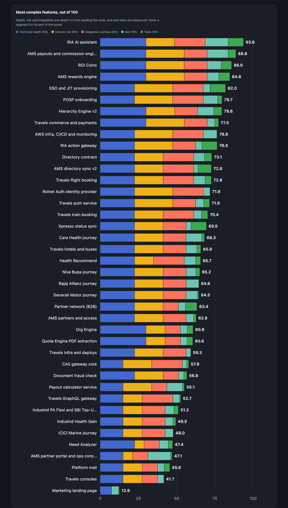

# Example: Roinet Developer Scorecard

A real run of the skill on 26 Nov 2026, across nine repos:
- **Insurance platform:** the parent repo and its server, app and ai-chatbot submodules
- **Connectors:** an insurer connector service
- **AMS:** an agency management system
- **Travel:** a travel-booking platform (flights, trains, hotels, buses, payments)
- **Payout calculator:** a payout calculator service, read through the GitHub API
- **Login:** an identity provider, read through the GitHub API without cloning

Developer names are replaced by their rank (Developer 1 is ranked first). Scores, features and line counts are as computed.

- **[Live demo](https://slasher190.github.io/engineering-scorecard/examples/roinet/report.html)**: the full report, hosted on GitHub Pages.
- [`report.html`](report.html): the same report as a file. Download it and open it in any browser.
- [`screenshots/overview.png`](screenshots/overview.png): podium, overall scores split by parameter, and code per repo.
- [`screenshots/features.png`](screenshots/features.png): the 40 rated features, scored out of 100.

