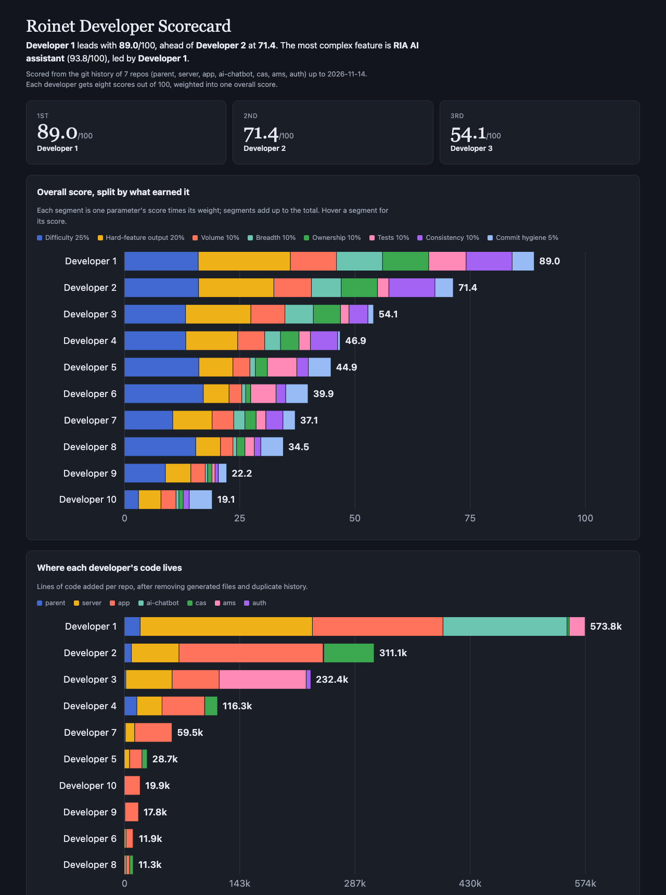

# Example: Roinet Developer Scorecard

A real run of the skill on 14 Nov 2026, across seven repos:
- **Insurance platform:** the parent repo and its server, app and ai-chatbot submodules
- **Connectors:** an insurer connector service
- **AMS:** an agency management system
- **Login:** an identity provider, read through the GitHub API without cloning

Developer names are replaced by their rank (Developer 1 is ranked first). Scores, features and line counts are as computed.

- [`report.html`](report.html): the full report. Download it and open it in any browser.
- [`screenshots/overview.png`](screenshots/overview.png): podium, overall scores split by parameter, and code per repo.
- [`screenshots/features.png`](screenshots/features.png): the 30 rated features, scored out of 100.

